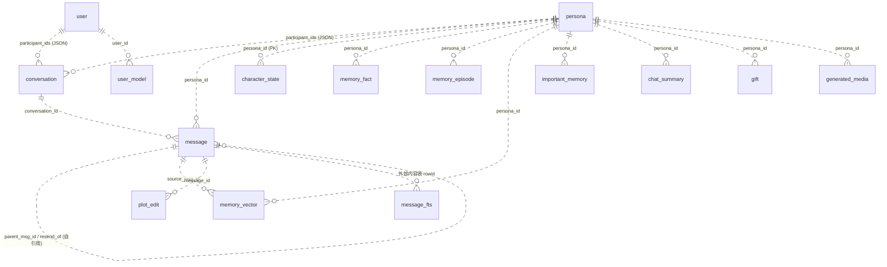
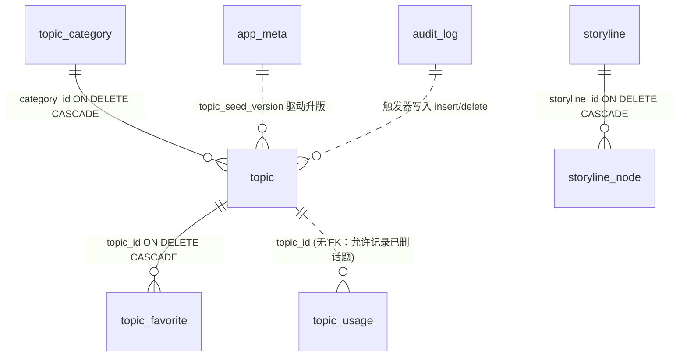
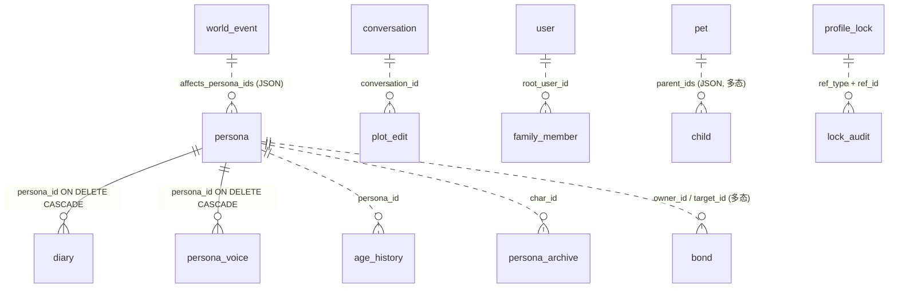
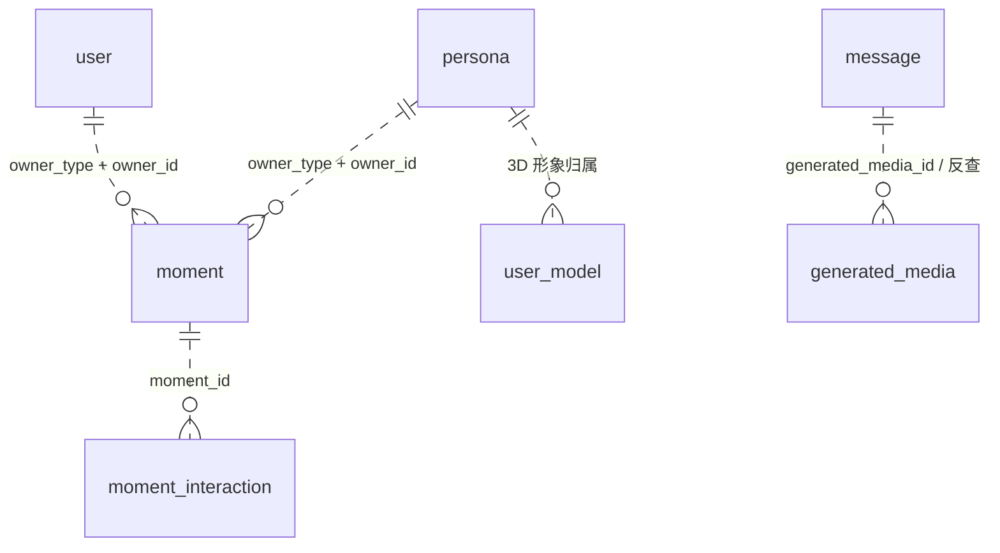
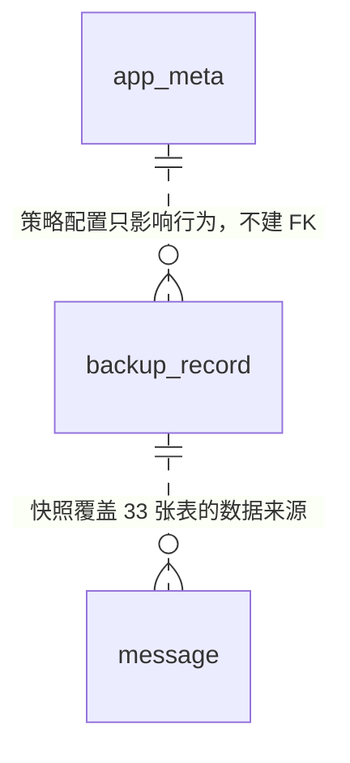

# 数据库架构文档 · private_ai_companion

> **适用范围**：本地端侧 SQLite 数据库（单库单文件 `companion.db`）。不含云端服务、不含 LLM 权重文件与模型下载缓存。
> **对应代码基线**：`lib/data/database/schema.dart` (`dbVersion = 5`)、`migrations.dart`、`app_database.dart`、`topic_seed.dart` (`builtinTopicSeedVersion = 3`)、`core/security/snapshot_cipher.dart` / `snapshot_key_store.dart`、`core/backup/*`。
> **文档日期**：2026-11-07（同日追加：加密快照正式落地，见 §6.4 / 附录 C）
> **数据来源**：本文所有表定义逐列对照源码 DDL；所有内容规模数字由 `buildTopicSeeds()` / `storylines` 运行时实测，非估算。

---

## 1. 架构概览

### 1.1 关键指标

| 指标 | 值 |
|---|---|
| Schema 版本 | `dbVersion = 5`（v1 基线 + v2/v3/v4/v5 增量） |
| 实体表 | **36 张**（v1 15 + v2 9 + v3 11 + v4 1） |
| 虚拟表 | 1 张 `message_fts`（FTS5 外部内容表，运行时探测创建） |
| 索引 | 40+ 个，含覆盖索引 / 部分索引 / 唯一索引 |
| 触发器 | 5 个（2 个话题审计 + 3 个 FTS 同步） |
| 内置话题 | **3271 条**（story 2758 / daily 513） |
| 话题分类 | **178 个**（35 个通用 + 143 个题材小类） |
| 剧情线 / 节点 | **14 条 / 70 节点** |
| 快照表白名单 | 33 张（`snapshotTables`） |
| 加密 | SQLCipher 整库页级加密，密钥存系统安全存储；**离库快照/导出默认 AES-256-GCM 密文**（§6.4） |
| 快照加密策略键 | `snapshot_encryption`（`device` / 缺省 = 开；`off` = 明文兼容）、`snapshot_passphrase_verifier` |

### 1.2 六条设计原则（读代码前先读这段）

1. **v1 表结构一个字段都不改。** 旧库已有用户聊天数据；SQLite 无法 `ALTER TABLE ADD CONSTRAINT`，重建 12 张表风险远大于收益。更关键的是各 Repository 普遍使用 `ConflictAlgorithm.replace`——一旦挂上真实外键，REPLACE 的隐式 DELETE 会级联删掉子行（保存角色 → 记忆被清空）。因此旧表用「索引 + 应用层约束 + 孤立行巡检」保证完整性，**新表一律使用真实 FOREIGN KEY / CHECK / UNIQUE**。
2. **所有增量 DDL 幂等**：全部带 `IF NOT EXISTS`，迁移可重复执行；加列前用 `PRAGMA table_info` 探测。
3. **内置内容与用户内容同表、按 `source` 区分**（`builtin` / `custom`）。内容升版只 `UPDATE` 内容字段，绝不碰 `enabled` / `created_at` / `source`——用户停用的话题不会被升级悄悄恢复。
4. **连接级 PRAGMA 与事务严格分离**：`onOpen` 里只做 WAL / busy_timeout / synchronous；FTS 探测、内容播种、留存清理必须放到 open 完成后的 `warmUp()`。sqflite(Android) 在 `onOpen` 期间持有打开锁，回调里开事务会永久等待，表现为 App 卡死在启动闪屏。
5. **运行时能力探测 + 降级**：FTS5 不可用时静默降级 LIKE 并写入 `app_meta`；`dbstat` 不可用时空间分析退回行数估算。功能永不因环境差异缺失。
6. **失败只降级、不阻断启动**：`warmUp()` 内每个环节独立 try/catch，失败下次冷启动重试；打开中的 Future 缓存失败自动清除，避免永久坏连接。

### 1.3 文件职责

| 文件 | 职责 |
|---|---|
| `schema.dart` | 唯一 DDL 真源：v1 基线、v2/v3/v4 增量、v5 加列、`snapshotTables`、`fileColumns` |
| `migrations.dart` | 逐版本迁移、FTS 探测与自愈、内置内容版本化播种、`app_meta` 读写、审计 |
| `app_database.dart` | 打开/加密/调优、`health()`、`tableCounts()`、`storageBreakdown()`、留存清理、`ANALYZE`/`VACUUM`/`wipeAll()` |
| `topic_seed.dart` | 内置话题与剧情线种子、紧凑行解析、内容质量分级权重 |
| `topic_genre_library.dart` + `rows/*.dart` | 23 大类 / 143 小类的题材库行数据 |
| `repositories/*.dart` | 每个领域的查询与写入，屏蔽 SQL |
| `core/topic/topic_service.dart` | 轮转推荐（去重 / 收藏加权 / 自建加权 / 随机扰动） |
| `core/backup/backup_service.dart` | 快照、校验、原子恢复、回滚点、媒体内联、轮转清理、**默认加密写入与密文/明文双分支读取** |
| `core/backup/export_service.dart` | 开放格式导出（JSON / CSV，**默认 `.aicbak` 密文**，显式 `encrypted: false` 才写明文） |
| `core/security/snapshot_cipher.dart` | AES-256-GCM 容器 v1：magic / AAD / 随机 nonce / tag、HKDF 与 PBKDF2 派生、`inspect()` 免解密读头 |
| `core/security/snapshot_key_store.dart` | 设备密钥生成/持久化/销毁（`FlutterSecureStorage` → Android Keystore / iOS Keychain / 桌面 DPAPI） |

---

## 2. ER 图

> **图例（重要）**
> - **实线 `||--o{`** = 数据库层 **真实 FOREIGN KEY**（新表，含 `ON DELETE CASCADE`）。
> - **虚线 `||..o{`** = **逻辑引用，无 FK 约束**（v1 表之间全部如此）。靠索引 + 应用层约定 + `health()` 孤立行巡检保证完整性。
> - 关系标签标注的是实际承载引用的列。字段完整定义见 §3 数据字典。

### 2.1 核心会话与记忆域



### 2.2 内容资产域（话题 / 剧情 / 推荐）

**本域是唯一全量使用真实外键的域**（v2 新建，无历史包袱）。



`topic_usage.topic_id` **刻意不加外键**：使用记录是历史埋点，话题被删（或用户自建话题被移除）时不应连带删除统计，也不应因 FK 失败阻断埋点写入。

### 2.3 世界模拟域（v3）



`bond` / `family_member` / `pet` / `child` 使用 **多态引用**（`owner_type` + `owner_id`、`member_type` + `ref_id`），因此无法建立单列外键；`parent_ids` / `affects_persona_ids` / `traits` 等为 JSON 数组字符串，属于刻意的反范式化，避免为「多对多且顺序有意义」的小数据建大量关联表。

### 2.4 社交 · 媒体 · 档案域



### 2.5 运维与备份域



`backup_record` 是**索引表**：快照文件本体落在 App 私有 `backups/` 目录，DB 里只存文件名、SHA-256、大小、schema 版本与行数统计。恢复时刻意**不恢复**这张表（否则本机记录会错乱）。

---

## 3. 数据字典

> 记号：`PK` 主键、`NN` NOT NULL、`FK` 真实外键、`UQ` 唯一约束、`CK` CHECK 约束。
> 类型沿用 SQLite 声明类型；`INTEGER` 时间戳统一为**毫秒 epoch**（`nowMs()`）。
> JSON 列（`tags` / `participant_ids` / `traits` / `stats` 等）均为 `TEXT`，存 `jsonEncode` 结果。

### 3.1 v1 基线（15 张，结构冻结，无真实外键）

#### `user` — 用户主档
| 列 | 类型 | 约束 | 说明 |
|---|---|---|---|
| `id` | TEXT | PK | 稳定标识 |
| `nickname` | TEXT | NN | 昵称 |
| `avatar_path` | TEXT | | 本地文件路径（导出时按 `fileColumns` 内联） |
| `birthday` | TEXT | | 生日 |
| `global_prefs` | TEXT | | JSON：全局偏好 |

#### `persona` — AI 角色主档（列最多、被引用最广）
| 列 | 类型 | 约束 | 说明 |
|---|---|---|---|
| `id` | TEXT | PK | |
| `name` | TEXT | NN | |
| `gender` / `age` / `identity` / `personality` / `speak_style` | TEXT / INTEGER | | 人设基础 |
| `likes` / `dislikes` / `background` / `world_setting` / `relation_base` / `taboos` / `fewshot` | TEXT | | 人设文本与少样本示例 |
| `avatar_path` / `bg_path` / `qmodel_path` | TEXT | | 本地文件（导出内联） |
| `persona_version` | INTEGER | | 人设修订版本 |
| `created_at` / `updated_at` | INTEGER | | 毫秒时间戳 |
| `worldview` | TEXT | NN DEFAULT 'realistic' | **v3 加列**：世界观 |
| `age_hidden` / `age_frozen` | INTEGER | NN DEFAULT 0 | **v3 加列**：年龄隐藏 / 冻结 |
| `ext` | TEXT | NN DEFAULT '{}' | **v3 加列**：扩展 JSON |
| `hidden_in_app` | INTEGER | NN DEFAULT 0 | **v4 加列**：隐私空间。放在列上而非偏好文件，是为了让所有列表查询**默认就过滤**，新页面不会漏出隐私角色 |

#### `conversation` — 会话
| 列 | 类型 | 约束 | 说明 |
|---|---|---|---|
| `id` | TEXT | PK | |
| `type` / `title` | TEXT | | 会话类型（单聊 / 群聊）/ 标题 |
| `participant_ids` | TEXT | | JSON 数组，逻辑引用 `user.id` / `persona.id` |
| `room_setting` | TEXT | | 场景设定 |
| `created_at` / `updated_at` | INTEGER | | |

#### `message` — 消息（核心事实表，索引最多）
| 列 | 类型 | 约束 | 说明 |
|---|---|---|---|
| `id` | TEXT | PK | |
| `conversation_id` | TEXT | | 逻辑引用 `conversation.id` |
| `sender_id` / `sender_type` / `persona_id` | TEXT | | 发送者多态标识 |
| `content` / `action_text` / `spoken_text` | TEXT | | 正文 / 动作描写 / 朗读文本（三者进 FTS） |
| `media_type` / `media_path` / `generated_media_id` | TEXT | | 媒体类型、本地路径、生成媒体引用 |
| `turn_id` | INTEGER | | 轮次（群聊多角色同轮） |
| `parent_msg_id` / `resend_of` | TEXT | | 自引用：引用回复 / 重发来源 |
| `is_deleted` | INTEGER | DEFAULT 0 | 软删 |
| `is_deleted_from_memory` | INTEGER | DEFAULT 0 | 仅从记忆中排除 |
| `is_important` | INTEGER | DEFAULT 0 | 重点消息（部分索引） |
| `recalled` | INTEGER | DEFAULT 0 | 撤回 |
| `recall_visible_to_other` / `recall_prompt_shown` / `recall_viewed_by_user` | INTEGER | DEFAULT 0 | 撤回可见性与提示状态 |
| `created_at` / `updated_at` | INTEGER | | |

#### `character_state` — 角色实时状态（一个角色一行）
`persona_id` PK；`mood` / `favor` / `love` / `anger` / `lust` / `reason` (REAL)；`inner_os` / `location` (TEXT)；`updated_at` (INTEGER)。

#### 记忆四表 + 摘要
| 表 | 列 |
|---|---|
| `memory_fact` | `id` PK, `persona_id`, `key`, `value`, `weight` REAL, `created_at` |
| `memory_episode` | `id` PK, `persona_id`, `title`, `detail`, `weight` REAL, `created_at` |
| `memory_vector` | `id` PK, `persona_id`, `content`, `embedding` (JSON 向量), `source_msg_id` (逻辑引用 message), `voided` DEFAULT 0, `created_at` |
| `important_memory` | `id` PK, `persona_id`, `content`, `weight` REAL, `created_at` |
| `chat_summary` | `id` PK, `persona_id`, `summary`, `version`, `updated_at` |

#### 社交与媒体
| 表 | 列 |
|---|---|
| `moment` | `id` PK, `owner_type`, `owner_id`, `content`, `images` (JSON 数组), `video_path`, `created_at` |
| `moment_interaction` | `id` PK, `moment_id`, `actor_type`, `actor_id`, `type`, `comment`, `created_at` |
| `generated_media` | `id` PK, `type`, `prompt`, `raw_prompt`, `owner_id`, `persona_id`, `file_path`, `created_at` |
| `user_model` | `id` PK, `user_id`, `source_image_path`, `model_path`, `created_at` |
| `gift` | `id` PK, `persona_id`, `gift_name`, `affect`, `created_at` |

> **注意**：v1 表全部使用 `ConflictAlgorithm.replace` 写入。这是「不挂 FK」的直接原因，也是 `health()` 必须做孤立行巡检的原因。

### 3.2 v2 增量（9 张：运维元数据 + 内容库 + 备份索引）

#### `app_meta` — 键值配置（本域的中枢）
| 列 | 类型 | 约束 | 说明 |
|---|---|---|---|
| `key` | TEXT | PK | |
| `value` | TEXT | NN | |
| `updated_at` | INTEGER | NN | |

**已登记的 key**（`migrations.dart` 常量）：

| key | 缺省 | 含义 |
|---|---|---|
| `fts_enabled` / `fts_tokenizer` / `fts_error` | 探测写入 | FTS 能力、实际 tokenizer、降级原因 |
| `topic_seed_version` | `0` | 内置内容版本，驱动 `ensureBuiltinContent` 升版 |
| `last_auto_backup_at` / `last_backup_message_at` | `0` | 自动备份节流与「期间有无新消息」判定 |
| `last_vacuum_at` | `0` | VACUUM 时间 |
| `auto_backup_enabled` | 开启 | 自动备份总开关（'0' 关闭） |
| `auto_backup_interval_hours` | `24` | 自动备份间隔 |
| `retention_days` | `0`（永久保留） | 数据留存天数，`kMinRetentionDays = 7` 下限保护 |
| `last_purge_at` | `0` | 留存清理 24h 节流 |
| `schema_baseline` | — | 迁移落点标记 |

#### `audit_log`
`id` INTEGER PK AUTOINCREMENT；`scope` / `action` NN；`ref_id` / `detail`；`created_at` NN。关键运维动作（备份 / 恢复 / 清空 / 降级安装）留痕。**不进快照白名单**（恢复会造成重复审计）。

#### `topic_category` — 话题分类
| 列 | 类型 | 约束 | 说明 |
|---|---|---|---|
| `id` | TEXT | PK | 一经发布不改名，否则用户收藏指向空分类 |
| `name` / `description` | TEXT | NN | |
| `kind` | TEXT | NN, CK `IN ('story','daily')` | 剧情向 / 日常向 |
| `sort_order` | INTEGER | NN DEFAULT 0 | 通用分类 10–63；题材库 2000+ |
| `created_at` | INTEGER | NN | |

#### `topic` — 话题（内容库主表）
| 列 | 类型 | 约束 | 说明 |
|---|---|---|---|
| `id` | TEXT | PK | 内置 `t_<分类>_<行号>`；自建 `t_custom_` 前缀 |
| `category_id` | TEXT | NN, **FK → topic_category ON DELETE CASCADE** | |
| `kind` | TEXT | NN, CK story/daily | |
| `stage` | TEXT | NN DEFAULT 'any' | 关系阶段：`any` / `early` / `familiar` / `close` |
| `tone` | TEXT | NN DEFAULT 'any' | 情绪：`any` / `warm` / `tense` / `mystery` / `bright` / `quiet` / `funny` / `epic` / `melancholy` |
| `scene` | TEXT | NN DEFAULT '' | 场景描述（继承分类默认值） |
| `title` / `content` | TEXT | NN | `content` 即点选后填入输入框、**可直接发送**的开场白 |
| `tags` | TEXT | NN DEFAULT '[]' | JSON 数组 |
| `source` | TEXT | NN DEFAULT 'builtin', CK `IN ('builtin','custom')` | 内置 / 用户自建 |
| `seed_version` | INTEGER | NN DEFAULT 1 | 升版时据此判断哪些行需要 UPDATE |
| `enabled` | INTEGER | NN DEFAULT 1, CK 0/1 | 用户停用状态，**升版 UPDATE 不碰** |
| `weight` | INTEGER | NN DEFAULT 100 | 推荐排序权重（v3 起含质量分级，见 §6.3） |
| `created_at` / `updated_at` | INTEGER | NN | `created_at` 升版不碰 |

#### `storyline` / `storyline_node` — 剧情线
`storyline`：`id` PK；`title` / `genre` / `setting` / `synopsis` NN；`tone` / `stage` DEFAULT 'any'；`difficulty` DEFAULT 1；`seed_version` DEFAULT 1；`enabled` DEFAULT 1 CK；`created_at` NN。
`storyline_node`：`id` PK；`storyline_id` NN **FK → storyline ON DELETE CASCADE**；`seq` NN；`title` / `opening` NN；`objective` / `twist` / `next_hint` DEFAULT ''；`created_at` NN；**UQ(`storyline_id`, `seq`)**。节点不可由用户编辑，升版覆盖是安全的。

#### `topic_usage` / `topic_favorite`
`topic_usage`：`id` INTEGER PK AUTOINCREMENT；`topic_id`（**无 FK**，历史埋点）；`persona_id` / `conversation_id`；`source` NN DEFAULT 'suggest'；`used_at` NN。轮转去重靠 `(persona_id, used_at DESC)` 索引。
`topic_favorite`：`topic_id` NN **FK → topic CASCADE** + `persona_id` NN 组成复合主键；`created_at` NN。

#### `backup_record` — 备份索引
`id` PK；`file_name` NN；`kind` NN CK `IN ('manual','auto','pre_restore')`；`created_at` / `size_bytes` / `schema_version` NN；`checksum` NN（SHA-256）；`row_counts` NN DEFAULT '{}'；`status` NN DEFAULT 'ok'。

### 3.3 FTS5 虚拟表（运行时创建）

```sql
CREATE VIRTUAL TABLE IF NOT EXISTS message_fts USING fts5(
  content, action_text, spoken_text, conversation_id UNINDEXED,
  content='message', content_rowid='rowid', tokenize='trigram'
)
```

- **外部内容表**（`content='message'`）：不重复存正文，靠 3 个触发器 `trg_message_fts_ai` / `_ad` / `_au` 同步。
- **tokenizer 降级链**：`trigram`（SQLite ≥ 3.34，支持中文子串）→ `unicode61`（连续中文不分词，检索自动 LIKE 兜底）→ 彻底禁用 FTS，全部走 LIKE。结论写入 `app_meta`，永久降级仅认 `no such module` / `not authorized`，临时故障（磁盘满 / 锁冲突）下次启动重试。
- **自愈**：`rebuildFtsIfStale()` 比对 `message` 与 `message_fts` 行数，不等则 `INSERT INTO message_fts(message_fts) VALUES('rebuild')`。

### 3.4 v3 世界模拟（11 张，全部真实 FK / CHECK / UNIQUE）

| 表 | 关键列与约束 | 用途 |
|---|---|---|
| `diary` | `id` PK；`persona_id` NN **FK→persona CASCADE**；`date` / `content` NN；`tier` DEFAULT 'shallow'；`encrypted` DEFAULT 0 CK；`mood`；`secret_tags` JSON；`auto_generated` DEFAULT 1 CK；`created_at` / `updated_at` NN；**UQ INDEX (`persona_id`,`date`,`tier`)** | 浅层相处日记与深层秘密日记是两条独立记录，避免同日互相覆盖 |
| `plot_edit` | `id` PK；`conversation_id` / `message_id`；`edit_mode` / `original_text` / `final_text` NN；`ai_draft`；`confirmed` DEFAULT 0 CK；时间戳 | 剧情改写留痕 |
| `bond` | `id` PK；`owner_type` / `owner_id` / `target_type` / `target_id` NN；`level` / `score`；`note`；`updated_at`；**UQ 四元组** | 多态羁绊 |
| `world_event` | `id` PK；`kind` / `worldview` / `title` NN；`detail`；`affects_persona_ids` JSON；`world_time`；`resolved` DEFAULT 0 CK；`created_at` | 世界事件待办（部分索引 `resolved, world_time DESC`） |
| `pet` | `id` PK；`name` / `category` / `owner_id` NN；`species` / `gender`；`age_months`；`traits` / `parent_ids` JSON；`bond_score`；`stats` JSON；`worldview` DEFAULT 'realistic'；时间戳 | 宠物与繁育 |
| `child` | `id` PK；`name` NN；`parent_ids` / `traits` / `personality` JSON；`born_at_world_time` / `age_months`；`appearance_genes` JSON；`life_stage` DEFAULT '婴儿'；`independent` DEFAULT 0 CK；`worldview`；时间戳 | 子代与成长 |
| `family_member` | `id` PK；`root_user_id` / `member_type` / `name` NN；`ref_id`；`generation`；`parent_ids` / `traits` JSON；`relation_label`；`worldview`；`created_at` | 家族树 |
| `persona_archive` | `id` PK；`char_id` / `name` / `snapshot` NN；`independent_timeline` DEFAULT 0 CK；时间戳 | 多套人设存档 |
| `profile_lock` | `id` PK；`ref_type` / `ref_id` / `lock_level` / `verifier` NN；`hint`；`enabled` DEFAULT 1 CK；**UQ(`ref_type`,`ref_id`)** | 档案锁 |
| `lock_audit` | `id` INTEGER PK AUTOINCREMENT；`ref_type` / `ref_id` / `action` NN；`actor`；`created_at` | 解锁审计（不进快照） |
| `age_history` | `id` PK；`persona_id` / `from_age` / `to_age` / `world_time` NN；`reason`；`created_at` | 年龄变迁 |

### 3.5 v4 / v5 声纹与声音克隆（1 张表 + 6 列）

`persona_voice`：`persona_id` PK **FK→persona CASCADE**；`source_kind` DEFAULT 'sample'；`source_name` / `source_path` / `playable_path`；`duration_ms`；`f0_mean` / `f0_std` / `energy` / `centroid` (REAL)；`embedding` JSON（16 维）；`fingerprint`；`created_at` / `updated_at`。

**v5 只加列、不建表、不搬数据**（全部 `NOT NULL DEFAULT`，老库无需回填，无「迁移写一半」中间态）：
`clone_provider` / `clone_voice_id` / `clone_model` / `clone_prompt_text` / `tts_voice` (TEXT DEFAULT '')、`clone_created_at` (INTEGER DEFAULT 0)。

> 设计理由：克隆是「这个角色用什么声音」的一部分，与声纹档案同生共死；一列主键一对一最省心，备份也不用多一张表白名单。

---

## 4. 索引、触发器与连接调优

### 4.1 索引策略（按意图分组）

| 类别 | 代表索引 | 意图 |
|---|---|---|
| 覆盖 / 组合 | `idx_message_conv_time (conversation_id, created_at DESC, id)` | 会话消息分页一次命中，避免回表排序 |
| 部分索引 | `idx_message_important ... WHERE is_important = 1` | 重点消息稀疏，索引体积最小化 |
| 筛选组合 | `idx_topic_filter (kind, enabled, stage, tone)` | 话题四维筛选 |
| 排序 | `idx_topic_category (category_id, weight DESC)` | 分类内按权重直出 |
| 升版 | `idx_topic_seed (source, seed_version)` | 快速找「停留在旧版」的内置行 |
| 轮转 | `idx_usage_recent (persona_id, used_at DESC)` | 最近用过去重 |
| 唯一约束 | `ux_diary_persona_date_tier` | 同角色同日同分层只允许一条 |
| 审计 | `idx_audit_time (created_at DESC)` / `idx_lock_audit` | 时间倒序查流水 |

### 4.2 触发器

| 触发器 | 作用 |
|---|---|
| `trg_topic_audit_insert` / `trg_topic_audit_delete` | 话题增删写 `audit_log` |
| `trg_message_fts_ai` / `_ad` / `_au` | 外部内容 FTS 表同步 |

**为什么只给新增内容表挂业务触发器**：旧表普遍用 REPLACE 写入，REPLACE 会触发隐式 DELETE，给旧表挂业务触发器会造成「保存角色误删记忆」这类灾难。

### 4.3 连接与打开参数

```
PRAGMA foreign_keys = ON     -- onConfigure，新表真实 FK 生效
PRAGMA journal_mode = WAL
PRAGMA busy_timeout = 5000
PRAGMA synchronous = NORMAL
password = <SecureCipherKeyProvider>  -- SQLCipher 整库页级加密
```

密钥存系统安全存储（Android Keystore / iOS Keychain / 桌面 DPAPI）。旧版明文库无法用密钥打开时，`_open()` 捕获 `not a database` / `file is encrypted` → 删除后重建一次（仅文件库，`:memory:` 不命中）。

---

## 5. 迁移史（v1 → v5）

| 版本 | 内容 | 幂等手段 |
|---|---|---|
| **v1** | 15 张基线表（用户 / 角色 / 会话 / 消息 / 记忆 / 动态 / 媒体 / 礼物） | 全新库 `onCreate` 原样建立 |
| **v2** | 运维元数据、话题内容库 6 表、备份索引、40+ 索引、2 个审计触发器 | 全部 `IF NOT EXISTS`；写 `schema_baseline=v2` |
| **v3** | 世界模拟 11 表；`persona` 加 4 列（worldview / age_hidden / age_frozen / ext） | 先去重历史重复 diary 行再建唯一索引（否则升级中断）；加列前 `PRAGMA table_info` 探测 |
| **v4** | `persona_voice`；`persona.hidden_in_app` | 同上，只能加列不能改列 |
| **v5** | `persona_voice` 加 6 列（声音克隆 / TTS 发音人） | 全部 `NOT NULL DEFAULT`，无需回填 |

- `onUpgrade` **逐版本执行、不允许静默跳过**：漏一版会让旧库缺表缺列，运行时才炸。
- `onDowngrade` **不删用户数据**，只写一条 `downgrade_refused` 审计，查询按现有列照常工作。
- 测试夹具可用 `dbVersionV1 = 1` 构造「老设备数据库」，验证升级链路。

### 5.1 内置内容版本化播种（独立于 schema 版本）

`topic_seed_version` 与 `dbVersion` 是**两个独立的版本号**：加内容不动表结构，只需 +1 内容版本。

```
current = app_meta['topic_seed_version']
if current >= builtinTopicSeedVersion and not force: return false   // 幂等
事务内：
  1. 查出 seed_version < 新版 的 builtin 行 / 剧情线 → stale 集合
  2. batch.update 只改内容字段（不含 enabled / created_at / source）
  3. batch.insert(... conflictAlgorithm: ignore) 补齐缺失行
  4. 剧情线节点跟随父线判断，stale 则覆盖（节点用户不可编辑）
  5. setMeta('topic_seed_version', 新版)
```

首启空库时 stale 集合为空，避免跑三千多条 no-op UPDATE 拖慢启动；v2 起统一 batch（仍在单事务内，往返次数从 N 降到 1）。

---

## 6. 备份、恢复、导出与数据策略

### 6.1 快照与恢复

- **逻辑 payload**：单文件 JSON，含 33 张 `snapshotTables` 的全部行 + schema 版本 + 行数统计 + **SHA-256 校验**（校验和始终按规范化明文 payload 计算，与是否加密无关）。
- **落盘格式（2026-11-07 起默认密文）**：payload 经 §6.4 的 AES-256-GCM 容器封装后写 `.aicbak`；`snapshot_encryption='off'` 或显式关闭加密时才写回 `.json` 旧格式。`verifyPath()` / `restoreFromPath()` 按 **magic 探测**分流，旧明文快照与回滚点继续可读、可校验、可恢复。
- **刻意排除**：`backup_record`（本机索引，恢复会错乱）、`audit_log` / `lock_audit`（流水日志，恢复会造成重复审计）、FTS 虚拟表与影子表（由内容表重建）。
- **媒体文件**：`fileColumns` 声明 7 张表的路径列（`moment.images` 是 JSON 数组，按子串替换），导出时把路径替换成占位符并把文件内联进快照，恢复时重新落盘并回写路径。
- **原子恢复**：事务内完成；恢复前自动生成 `kind='pre_restore'` 回滚点（自动动作强制使用设备密钥，不依赖口令）；失败整体回滚。
- **清理**：按类型轮转，避免备份文件无限增长；`deleteAll()` 同时覆盖 `.json` / `.aicbak` / `.tmp`。
- **自动备份**：默认开启 / 24h；距上次超过间隔**且期间有新消息**才生成备份（空库重复启动不刷屏）。

### 6.2 数据策略（v3 补齐，全部存 `app_meta`，零 schema 变更）

| 能力 | 实现 | 安全边界 |
|---|---|---|
| 自动备份开关 + 间隔 | `setAutoBackupEnabled` / `setAutoBackupIntervalHours` | 缺省开启 / 24h |
| 数据留存 | `purgeOldMessages({force})` 硬删 `message` 早于 cutoff 的行 | `0` = 永久保留；`kMinRetentionDays=7` 下限；24h 节流；UI「立即清理」可 force；失败只降级 |
| 空间占用分析 | `storageBreakdown()` | `dbstat` 优先，行数估算兜底 |
| 快照加密开关 | `snapshotEncryptionEnabled()` / `setSnapshotEncryption()` | 缺省（键不存在）视为 **开启**；显式写 `'off'` 才降级为明文，避免「升级后老用户突然变明文」 |
| 归档口令 verifier | `setArchivePassphraseVerifier()` / `checkArchivePassphrase()` | 只存**不可逆派生校验值**；口令不落库、不进日志、不进快照，忘记后无法找回 |
| 设备密钥销毁 | `destroySnapshotKey()` | 紧急清空时销毁；此后**此前复制出去的设备加密备份也永久无法解密** |
| 开放格式导出 | `ExportService.exportChats(format: json\|csv, encrypted: true)` | **默认 AES-256-GCM 密文 `.aicbak`**；明文必须显式 `encrypted: false` 且 UI 二次确认 |

**留存清理的引用安全**：只删 `message` 表。`parent_msg_id` / `memory_vector.source_msg_id` / `plot_edit.message_id` 等引用在 v1 均无真实外键，不会级联崩坏；残留悬空引用由 `health()` 的孤立行巡检照常上报。

### 6.3 内容质量分级（v3 新增，数据层面的"精修调度"）

审计发现 v2 题材库 **2861 条中 1972 条（68.9%）正文只有一段括号动作描写**（如「（只有四张桌子）」），平均正文 11.2 字，93% 短于 20 字——点选后并不能作为开场白直接发送。另有 5 条不足 10 字的过短正文，合计 **1977 条低可读性正文**（占全库 65.0%）。

**处理方式不是删除或改写 1977 条存量**（会破坏 id 稳定性且工作量/风险极高），而是在 `_parseRows` 里按可读性分档写入 `weight`：

```
lowReadability = 仅一段括号动作描写 || 正文 < 10 字
weight = (lowReadability ? 45 : 100) + ((行号 * 7) % 23)   // 轻微错位，避免每轮撞同一批
```

配合 `TopicRepository.query` 的 `ORDER BY weight DESC, id ASC LIMIT 400`：高质量内容 1294 条 > 400，**推荐位全部由可直接发送的完整开场白占据**；低可读性行不删除、不停用，仍可被搜索、分类浏览与池子补齐命中，只是不再抢推荐位。升版时 `weight` 随内容字段一起 UPDATE 下发到老设备。

### 6.4 加密快照容器 v1（2026-11-07 正式落地）

#### 6.4.1 为什么单独做一套，而不是复用 `CryptoService`

`CryptoService` 是 SHA-256 派生密钥流 XOR + HMAC 的轻量隐私加密，服务于**留在库内**的档案锁与深层日记。归档快照/导出文件会离开 App 私有目录、被复制到网盘或另一台设备，威胁模型不同：必须同时有**机密性**与**强篡改检测**，且不能依赖「文件仍在本机」这一前提。因此改用标准 **AES-256-GCM AEAD**（`pointycastle` 纯 Dart 实现，无新增原生库、不增 APK 原生体积）。`CryptoService` 保持原样，两者用途隔离、密钥不共用。

#### 6.4.2 容器布局（`snapshot_cipher.dart`，全小端，44 字节固定头）

| 偏移 | 长度 | 字段 | 说明 |
|---|---|---|---|
| 0..5 | 6 | magic `AICENC` | 以非 JSON 起始字节开头，靠**内容探测**而非扩展名区分密文/旧明文 |
| 6 | 1 | version = 1 | 结构变更必须递增并保留旧版读取 |
| 7 | 1 | mode | `1` = device，`2` = passphrase |
| 8..11 | 4 | iterations | PBKDF2 轮数；device 模式为 0 |
| 12..27 | 16 | salt | 设备密钥 HKDF / 口令 PBKDF2 共用 |
| 28..39 | 12 | nonce | 每次加密重新随机，绝不复用 |
| 40..43 | 4 | ciphertext length | uint32；避免 dart2js 不支持 `getUint64` |
| 44.. | n+16 | ciphertext ‖ GCM tag | tag 16 字节 |

**整个 44 字节头作为 GCM 的 AAD**：mode / 迭代数 / salt / nonce / 长度任何一处被改动都会导致 tag 校验失败，杜绝「把口令加密降级成设备加密」「调低 PBKDF2 轮数」这类降级攻击。解密前先按头里声明的长度与 `maxPlainBytes = 64MB` 校验再分配缓冲区，挡住超大密文 OOM。

> 实现坑：`pointycastle` 的 `AEADParameters.macSize` 单位是 **bit**（内部再 /8），传 `16` 会被判非法；16 字节 tag 必须传 `tagLength * 8 = 128`。

#### 6.4.3 密钥体系（`snapshot_key_store.dart`）

| 模式 | 派生 | 密钥材料 | 适用 | 跨设备 |
|---|---|---|---|---|
| `device` | HKDF-SHA256(deviceKey, salt, info=`private_ai_companion.snapshot.v1`) | 32B 随机数存 `FlutterSecureStorage` alias `companion.snapshot.key.v1` → Android Keystore / iOS Keychain / 桌面 DPAPI | 自动备份、回滚点、默认手动备份、默认聊天导出 | ❌ 换设备不可解密 |
| `passphrase` | PBKDF2-HMAC-SHA256(口令, salt, 60000 轮，头内可平滑提高) | 用户口令，仅存在于本进程内存 | 「口令归档」人工生成的可携带快照 | ✅ 只需口令 |

口令**不落库、不进日志、不进快照**；`app_meta.snapshot_passphrase_verifier` 只写不可逆派生校验值，用于 UI 校验「是否输入了同一个口令」，无法反推口令。测试用 `StaticSnapshotKeyStore` 注入，不触碰插件通道。

#### 6.4.4 调用链与策略

```
BackupService.create(kind, encryption?, passphrase?)
  └─ _resolveEncryption(kind, encryption, passphrase)
       ├─ 自动备份 / pre_restore 回滚点 → 强制 device（无人值守动作不依赖口令）
       ├─ 显式 encryption == null 且策略 off → 明文 JSON（兼容分支）
       └─ 其余 → device；指定 passphrase 模式 → 口令归档
  └─ 规范化 JSON（SHA-256 checksum）→ SnapshotCipher.encrypt → .aicbak

BackupService.verifyPath / restoreFromPath / verify / restore
  └─ SnapshotCipher.isEncrypted(bytes) ? decrypt(...) : 旧明文分支
       └─ inspect() 读头 → needsPassphrase → UI 弹口令输入

ExportService.exportChats(format, encrypted: true, mode, passphrase?)
  └─ 流式逐会话写 tmp → _seal() 整体加密覆盖 tmp → 原子 rename 为 _json.aicbak / _csv.aicbak
```

- 文件命名：`backup_<kind>_<stamp>_<now>_<seq>.aicbak`（明文为 `.json`）；导出文件保留内部格式后缀 `companion_chat_export_..._json.aicbak`，解密后按后缀决定 JSON/CSV 解析。
- 导出密文上限 `maxEncryptedExportBytes = 32MB`；`readExport()` 自动识别密文并解密，`_isExportFile()` 同时识别 `.aicbak`。
- 策略键缺省视为**开启**：老用户升级后不会突然退化成明文；只有显式 `setSnapshotEncryption(false)` 写 `'off'` 才降级。
- 紧急清空链路：`BackupService.deleteAll()` → `destroySnapshotKey()` → `ExportService.deleteAll()` → `AppDatabase.wipeAll()`。销毁设备密钥后，本机及此前复制出去的设备加密备份**永久不可解密**，UI 已明确告知。

#### 6.4.5 诚实边界

- 加密保护的是**离开 App 私有目录的文件**；数据库本体仍由 SQLCipher 页级加密负责，两套密钥互不相干。
- `device` 模式无法跨设备恢复，这是刻意取舍；跨设备请用「口令归档」，口令丢失无任何找回途径。
- 明文兼容分支仍然保留（读旧快照 + 显式关闭加密），UI 对「关闭加密」和「明文导出」都做二次确认并写明泄漏风险。
- 未接系统级分享（`share_plus` / SAF），加密文件仍需用户自行从文件管理器取走；这属于导出「最后一公里」，不是加密缺口。

#### 6.4.6 回归测试

`test/snapshot_cipher_test.dart`（纯 Dart 容器）：device 往返、旧明文不误判、口令跨设备、错口令/缺口令、错设备密钥、密文 / header / tag 篡改、截断、随机 salt/nonce、非法输入、密钥用途隔离。

`test/encrypted_snapshot_test.dart`（真 SQLite + 真实 AES-GCM）：默认密文快照、磁盘无明文、篡改拒绝、加密恢复、密文回滚点、跨设备口令归档、verifier 不存口令、关闭加密兼容、策略不回退、自动备份设备密钥、清空备份销毁 key、导出默认加密 / 显式明文、口令导出校验。既有 `backup_service_test.dart` / `backup_hardening_test.dart` / `db_policies_test.dart` 固定 `snapshot_encryption='off'`，专门守住旧明文兼容分支。

---

## 7. 差距审计

### 7.1 逐项对照原始诉求

| 诉求 | 现状 | 结论 |
|---|---|---|
| **足够的剧情向话题** | 2758 条 story；143 个题材小类（23 大类）每类 ≥20 条；14 条剧情线 / 70 节点，含 5 字段（开场 / 目标 / 转折 / 后续提示） | ✅ 超额。轮转推荐按角色去重 60 次、收藏与自建加权 |
| **足够的日常聊天话题** | v2 仅 9/143 个题材小类是 daily，日常向合计 285 条（其中通用 daily 15 类约 105 条）→ **v3 补齐后 513 条**：新增 9 个生活场景分类 + 228 条完整开场白 | ✅ 已补齐（+228 条 / +80%）；这是本次审计发现的最大短板 |
| **备份用户聊天数据** | SHA-256 快照 + **AES-256-GCM 离库加密** + 设备密钥 / 口令归档 + 事务原子恢复 + pre_restore 回滚点 + 媒体内联 + 轮转清理 + 可配置自动备份 + 默认加密开放格式导出 | ✅ 生产级，覆盖「可恢复 / 可校验 / 可迁移 / **可保密**」四要素（见 §6.4） |
| **市面上常用的 DB 功能** | 见 §7.3 功能矩阵 | ✅ 主流能力齐备；剩余差距见 §7.4 |

### 7.2 内容质量基线（运行时实测，非估算）

| 指标 | v2 | **v3** | 变化 |
|---|---|---|---|
| 话题总数 | 3043 | **3271** | +228 |
| 通用分类 | 26 | **35** | +9（通勤 / 家务 / 购物 / 节日 / 记账 / 社交 / 出行 / 独处 / 设备） |
| 全部分类 | 169 | **178** | +9 |
| story / daily | 2758 / 285 | **2758 / 513** | +228 条日常向（+80%）；剧情向数量不变 |
| 剧情线 / 节点 | 10 / 50 | **14 / 70** | +4 条治愈 / 轻悬疑 / 都市奇幻 / 怀旧长线 |
| 低可读性正文 | 1977 (65.0%) | **1977 (60.4%)** | 条数不变、占比下降；全部降权，不占推荐位 |
| 完整开场白（高权重） | 1066 | **1294** | +228（新增 228 条全部为完整开场白） |
| 全库正文重复 | 0 | **0** | 契约守住 |
| 显式 stage 标注 | any 主导 | any 2981 / familiar 72 / close 216 / early 2 | 新增内容显式标注，筛选可用 |
| 剧情节点字段缺失 | 0 | **0** | 契约守住 |

> **id 稳定性验证**：`buildTopicSeeds()` 运行时实测 3271 条 id 全唯一；`daily_food` 前 7 条 id (`t_daily_food_1..7`) 完全不变，新增行从 `t_daily_food_8` 接续 → **用户收藏与停用状态不会因本次扩充错位**。

### 7.3 常用数据库功能矩阵

| 能力 | 状态 | 落点 |
|---|---|---|
| 整库加密 | ✅ | SQLCipher + 安全存储密钥 |
| 全文检索（中文） | ✅ | FTS5 trigram → unicode61 → LIKE 三级降级 |
| 逐版本迁移 / 降级保护 | ✅ | v1→v5 幂等 DDL |
| 覆盖 / 部分 / 唯一索引 | ✅ | 40+ 索引 |
| 审计日志 + 触发器 | ✅ | `audit_log` / `lock_audit` |
| 完整性巡检 | ✅ | `health()`：integrity_check / FK check / 孤立行 |
| 表统计 / 空间分析 | ✅ | `tableCounts()` / `storageBreakdown()`（dbstat 优先） |
| ANALYZE / VACUUM | ✅ | `analyze()` / `vacuum()`（VACUUM 后重建 FTS） |
| 事务化紧急清空 | ✅ | `wipeAll()` |
| 数据留存 / 定期清理 | ✅ | `purgeOldMessages()`，节流 + 下限保护 |
| 自动备份（可配置） | ✅ | `app_meta` 开关 + 间隔 |
| 快照校验 + 原子恢复 + 回滚点 | ✅ | `BackupService` |
| 离库快照 / 导出加密 | ✅ | AES-256-GCM 容器 v1 + 系统安全存储设备密钥 + PBKDF2 口令归档（§6.4） |
| 归档口令校验（不可逆 verifier） | ✅ | `snapshot_passphrase_verifier`；口令不落库 |
| 加密密钥销毁闭环 | ✅ | 紧急清空调用 `destroySnapshotKey()` |
| 旧明文快照兼容读取 | ✅ | magic 探测双分支，既有测试固定 `'off'` 守护 |
| 开放格式导出 / 分享 | ⚠️ 部分 | JSON / CSV **默认加密**导出到文件；**系统分享**未接（无 `share_plus` 依赖，需用户手动取文件） |
| 内容版本化分发 | ✅ | `topic_seed_version` 独立升版 |
| 云端同步 / 跨设备 | ❌ 无 | 隐私优先 app 的**主动取舍**，非缺陷 |
| 行级版本 / 增量同步 / 冲突解决 | ❌ 无 | 单机单用户场景不需要 |

### 7.4 剩余差距与风险（诚实清单）

| # | 差距 | 影响 | 建议 |
|---|---|---|---|
| 1 | **v1 表无真实外键** | 依赖应用层约束，REPLACE 与孤立行风险 | 已由 `health()` 巡检 + 索引缓解；**不要**为了「规范」给旧表补 FK（会级联误删记忆）。保持现状并在新代码中继续遵守 |
| 2 | **1977 条低可读性正文仍在库** | 搜索/分类浏览时仍会露出纯动作描写 | 已降权隔离推荐位；根治需分批重写，且必须**只改同一行正文、不动行号**（id 稳定性） |
| 3 | **stage 标注 91% 为 `any`** | 关系阶段筛选区分度低 | `query` 用 `stage IN ('any', ?)` 兜底，不会空池；后续可按角色阶段精标 |
| 4 | **剧情线 14 条 vs 143 题材小类** | 长线内容覆盖仍偏窄 | 按季度增补，每条 5 节点，追加在 `storylines` 末尾 |
| 5 | **`snapshotTables` 需手动维护** | 新增表若漏加白名单，备份会**静默丢数据** | ⚠️ **优先级最高**：补一条测试，断言「所有实体表（除白名单排除项）都在 `snapshotTables` 中」 |
| 6 | FTS 降级路径缺自动化测试 | 老设备 LIKE 兜底逻辑未被测到 | 增加注入「无 FTS5 模块」的 FFI 测试 |
| 7 | 标题存在 ~53 处重复（跨题材小类） | 「换一批」偶有既视感 | 正文已保证零重复；标题重复多为不同题材同名，可接受 |
| 8 | 无系统级分享 | 导出文件需用户自行取用 | 引入 `share_plus` 后接 `ExportService`，属可选增强 |
| 9 | 留存清理后残留悬空引用 | `memory_vector.source_msg_id` 等指向已删消息 | `health()` 会上报；如需要可补一次「清理悬空引用」维护任务 |

> **差距销项（2026-11-07）**：此前清单里的「本地加密快照 / 加密导出」已正式实现（§6.4），**不再是差距**。剩余的真实边界是 §6.4.5 的四条：设备模式不跨设备、口令不可找回、明文兼容分支仍需二次确认、系统级分享未接。这些是设计取舍或未接通道，不是加密缺陷。

### 7.5 内容契约（新增内容必须满足）

由 `test/topic_library_test.dart`、`test/topic_genre_library_test.dart` 守护：

1. 行格式 `标题|正文|标签[|stage=xx;tone=xx]`，正文**不含** `|`；
2. `title` / `content` / `tags` 非空；`stage` / `tone` 必须在枚举内；
3. `topic.kind` 必须与所属分类 `kind` 一致；
4. 每个分类都要有内容；通用分类 ≥6 条、题材小类 ≥20 条；
5. 全部种子 id 唯一；题材库正文全库不重复、长度 6–60 字；
6. 剧情线 id 唯一、每条 ≥4 节点，`opening` / `objective` / `twist` 非空；
7. **行数据只能在分类数组末尾追加**，禁止中间插入 / 删除 / 重排（id = `t_<分类>_<行号>`）。修订文案改同一行正文即可。
8. 每次扩充内置内容 **必须 `builtinTopicSeedVersion + 1`**，否则老设备拉不到新内容。

---

## 8. 后续路线（按优先级）

> 原列在此处的「本地加密导出」已于 2026-11-07 落地并从路线移除；下表只保留仍未完成项。

| 优先级 | 事项 | 理由 |
|---|---|---|
| P0 | 为 `snapshotTables` 覆盖面加自动化断言 | 唯一会「静默丢用户数据」的风险点 |
| P1 | 分批重写 1977 条低可读性正文（只改同行正文，不动行号） | 从「降权隔离」升级为「根治」，提升搜索与分类浏览体验 |
| P1 | 按关系阶段精标 `stage`，降低 `any` 占比 | 让阶段筛选真正参与个性化 |
| P2 | 季度增补剧情线（每条 5 节点） | 长线内容仍偏窄 |
| P2 | 接 `share_plus` 打通导出文件分享 | 补齐「开放格式导出」最后一公里 |
| P2 | FTS 降级路径自动化测试 | 覆盖老设备真实环境 |
| P3 | 悬空引用清理维护任务 | 配合留存策略长期运行 |
| P3 | 将本文档的 ER 图与数据字典纳入 CI 一致性检查（表数 / 白名单 / 版本） | 防止文档与代码漂移 |

---

## 附录 A：表清单速查

**v1（15）**：`user` `persona` `conversation` `message` `character_state` `memory_fact` `memory_episode` `memory_vector` `important_memory` `chat_summary` `moment` `moment_interaction` `generated_media` `user_model` `gift`

**v2（9）**：`app_meta` `audit_log` `topic_category` `topic` `storyline` `storyline_node` `topic_usage` `topic_favorite` `backup_record`

**FTS（1 虚拟表）**：`message_fts`（+ 4 张 fts5 影子表，由 SQLite 自行管理）

**v3（11）**：`diary` `plot_edit` `bond` `world_event` `pet` `child` `family_member` `persona_archive` `profile_lock` `lock_audit` `age_history`

**v4（1）**：`persona_voice`

**快照白名单（33）**：上述 36 张实体表减去 `backup_record` / `audit_log` / `lock_audit` 三张刻意排除表，不含 FTS 影子表。

## 附录 B：本次（2026-11-07）数据工程改动索引

| 提交 | 内容 |
|---|---|
| `870d75c` | 补齐常用功能：数据留存清理、空间占用分析、可配置自动备份、开放格式导出（`app_meta` 零 schema 变更） |
| `f36572c` | 内容精修：9 个新日常分类 + 228 条完整开场白 + 4 条剧情线 + 质量分级权重 + `builtinTopicSeedVersion 2→3`；产出本文档 |
| 本次 | 加密快照正式落地：AES-256-GCM 容器 + 设备密钥/口令归档 + 备份/恢复/导出/设置页/紧急清空全链路 + 旧明文兼容 + 回归测试；见 §6.4 / 附录 C |

## 附录 C：加密快照改动索引（2026-11-07）

| 文件 | 变更 |
|---|---|
| `pubspec.yaml` / `pubspec.lock` | 新增纯 Dart `pointycastle ^3.9.1`（+ 传递 `convert` / `js`），**无新增原生库** |
| `core/security/snapshot_cipher.dart` | 新增：容器 v1、AES-256-GCM、HKDF / PBKDF2、`isEncrypted` / `inspect` / `encrypt` / `decrypt` |
| `core/security/snapshot_key_store.dart` | 新增：`SnapshotKeyStore` 抽象 / `SecureSnapshotKeyStore` / `StaticSnapshotKeyStore` |
| `data/database/migrations.dart` | 新增 `metaKeySnapshotEncryption` / `metaKeySnapshotPassphraseVerifier`（**零 schema 变更**） |
| `core/backup/backup_service.dart` | 默认密文写入、magic 双分支读取、`restoreFromPath` / `inspectPath`、策略与密钥 API、`.aicbak` 清理 |
| `core/backup/export_service.dart` | 默认加密导出、`_seal()`、`readExport()` 自动解密、明文需显式 `encrypted: false` |
| `app/di.dart` | 备份与导出共享同一 `SecureSnapshotKeyStore` 实例 |
| `features/settings/backup_page.dart` | 加密开关、加密/明文导出、口令归档、导入快照、按需弹口令 |
| `features/settings/privacy_page.dart` | 紧急清空销毁设备密钥，并如实告知旧密文不可解 |
| `test/snapshot_cipher_test.dart` / `test/encrypted_snapshot_test.dart` | 新增容器单测与真 SQLite 集成测试 |
| `test/backup_service_test.dart` / `backup_hardening_test.dart` / `db_policies_test.dart` | 固定 `'off'`，守护旧明文兼容分支 |
