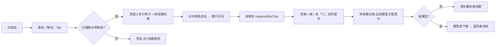
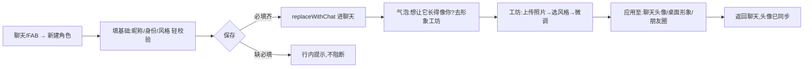

# 私人 AI 陪伴 App · 用户体验与导航重构设计（UX Spec）

> **角色**：经验丰富、做事严谨的 UX 设计师
> **目标**：设计用户操作流程、页面跳转逻辑，优化使用体验，让 App 更好上手
> **依据**：① 真实代码现状（已逐页读取 `app_shell / chat_list_page / role_create_page / avatar_studio_page / router / settings` 等）；② 既有 PRD《私人 AI 陪伴 App 产品需求文档》第 7（页面结构与导航）、第 8（功能流程图）章。
> **说明**：本设计为增量优化方案，不重复 PRD 已定义的业务流程（剧情/日常/朋友圈/桌面/记忆/微信联动等），聚焦 **「上手门槛、导航收敛、跳转语义」** 三件事。上一轮已落地的工坊步骤条 / 空状态引导 / 调参搜索、聊天列表整行可点、创建后 `replaceWithChat`、深链保留底部导航，本文直接固化为「已实现·沿用」。

---

## 0. 设计原则（红线）

1. **首启不打断，但必须指路**：禁止全屏阻塞式首启向导；用情境引导（列表顶部卡片 + 关键时刻气泡）替代。
2. **主路径 1 步可达**：用户 80% 的高频动作（开始聊天、创建角色）应在 1–2 次点击内完成。
3. **返回语义可预测**：创建/编辑完成后的「返回」必须落回内容列表，而非空表单；深链进二级页必须保留底部导航。
4. **诚实不误导**：未装端侧模型时明确标注「体验模式 / 演示脚本」，不让人误以为那就是 AI。
5. **入口单一归属**：一个能力只在一个地方"拥有"，其余为"消费方"深链跳转，避免三处入口各自藏一份。

---

## 1. 现状梳理（As-Is）

### 1.1 已实现的信息架构（真实代码）

- **主壳 `AppShell`**：底部四 Tab —— 聊天 / 朋友圈 / 桌面伴生 / 我的（`IndexedStack` 保活，切 Tab 时 `_chatRev++` 强制刷新列表）。
- **聊天 Tab（`ChatListPage`）**：承载 最近对话 / 群聊 / 角色 三段；角色行**整行可点**直达聊天（主路径 1 步，已优化）；三点菜单收「新开·剧情 / 新开·日常 / 编辑人设 / 换头像背景」；右下 FAB `+` 弹「新建角色 / 创建群聊」。首启有**三步引导卡** + **体验模式条**。
- **角色创建（`RoleCreatePage`）**：基础（昵称/身份/风格）+ 高级 + 第 21 章字段，存为全局人设卡（SSOT）；保存后 `replaceWithChat` 直接进聊天。
- **工坊（`AvatarStudioPage`）**：照片→写实/Q版/融合三风格→87 项逐部位微调；上一轮已加步骤条、空状态、「去创建角色」跳转、调参搜索/匹配计数、成人选项折叠。
- **模型库（`ModelCatalogPage`）**：安装端侧模型。
- **设置中心（`SettingsPage`）**：实际挂载 ~25 个子页（角色管理/记忆/模型源/AI生成/隐私与数据/通知/语音/世界规则/应用锁/备份……）。

### 1.2 已暴露的上手断点（痛点 · 设计要解的问题）

| # | 痛点 | 影响 |
|---|---|---|
| P1 | **首启引导是"卡片"不是"旅程"**：PRD 明确「启动引导页」未实现；当前仅在聊天列表顶部有一张 3 步卡，且**只在聊天 Tab 出现**。新用户若首启直接点「朋友圈/桌面/我的」，完全无引导，易迷失。 | 首启转化低 |
| P2 | **视觉/3D 工坊入口散落三处、归属不清**：工坊可从「桌面伴生 / AI 生成 / 我的(设置)」三处进入，用户想"把角色做成我的样子"要在三个地方找。 | 功能渗透低、认知负担高 |
| P3 | **角色创建 ↔ 视觉造型 ↔ 应用 链路薄弱**：`role_create` 只给头像/背景图片选择，真正的 3D 工坊在外；创建完直接进聊天，**没有"顺手做个形象"的引导**。 | 视觉工坊渗透低 |
| P4 | **设置中心 ~25 子页平铺**：无分组、无搜索，深翻成本高，新用户找不到"模型/隐私/角色管理"。 | 高级功能可达性差 |
| P5 | **工坊 87 项调参偏"专业工具"**：虽已补搜索/步骤条/空态，但首次进入仍缺渐进式披露，普通用户易被淹没。 | 上手劝退 |
| P6 | **群聊前置门槛（需 ≥2 角色）**：仅在 FAB 菜单里提示，列表"群聊"段无上下文引导，角色<2 时用户不知先去创建。 | 群聊创建卡顿 |

---

## 2. 设计目标与可衡量指标

| 指标 | 现状（估） | 目标 |
|---|---|---|
| 首启 24h 内发生 ≥1 条用户消息（首次会话转化） | 低（仅聊天 Tab 有引导） | 显著提升，跨 Tab 也有指路 |
| 角色创建完成率（开始→保存） | 中 | 必填轻校验 + 创建后引导，↑ |
| 视觉工坊渗透率（创建后 7 日内进入） | 低（入口散） | 单一归属 + 创建后气泡，↑ |
| 任意功能从主壳到达的点击数 | 深翻可达 5–6 次 | ≤ 4 次（含搜索） |

---

## 3. 信息架构重构（Proposed IA）

### 3.1 底部四 Tab（保持不变，只重排"我的"内部）

保持 **聊天 / 朋友圈 / 桌面伴生 / 我的** 四 Tab。导航成本已低，不必改 Tab 数。

### 3.2 「我的」内部重组：~25 子页收成 5 组

当前设置页子页平铺（P4）。建议分组 + 搜索/常用置顶：

1. **我的角色**：角色管理、形象工坊（视觉 3D 编辑台，单一归属）
2. **记忆与数据**：记忆管理、备份、隐私与数据（无护栏·法律底线·紧急清空）
3. **模型与生成**：模型源与下载、AI 生成、用户建模
4. **互动设置**：桌面伴生开关、通知、语音、世界规则
5. **账户**：个人资料、应用锁

> 组头为不可点分区，组内条目可搜索；"模型源"与"隐私与数据"因涉及红线，始终置顶可见。

### 3.3 形象工坊单一归属（解 P2/P3）

- 工坊是"**角色视觉**"的编辑台，**归属到「我的角色 → 形象工坊」**，全 App 只此一个拥有入口。
- 「桌面伴生」「AI 生成」「聊天外观页」作为**消费方**，以底部按钮 **深链跳转（`personaId`）** 进入工坊，返回回到消费方——不再各自藏一份入口。
- 工坊顶部沿用上轮步骤条：**角色 →（照片）→ 造型 → 微调 → 生成 → 应用**，并新增「应用至」三落点：**聊天头像 / 桌面形象 / 朋友圈头像**，让"做完形象"立刻有去处（解 P3）。

---

## 4. 核心用户流程（含决策与兜底）

### 4.1 新用户首次会话（Aha 流 · 解 P1）

- **关键决策**：引导卡**只在聊天 Tab 出现即可**——因为首启默认落地聊天 Tab，且示例角色就在眼前，这是最短 Aha 路径（≤3 次点击发出首条）。
- **兜底**：若用户首启直接点其它 Tab，在「我的」首次进入时补一张同款极简引导卡（指回聊天 Tab 的示例角色），消除 P1 的跨 Tab 迷失。

### 4.2 创建"我的角色"并做成我的样子（解 P3）

- **关键决策**：创建完成**不**停留表单、不弹冗长"高级设置"，直接进聊天并给一条**非阻塞气泡**引导去工坊，把"做形象"变成顺手动作而非任务。
- **兜底**：角色<2 时，列表「群聊」段直接给"先创建一个角色"按钮（解 P6）。

### 4.3 回流 / 日常循环

启动 →（可选）收到角色问候通知（锁屏不带内容，已合规）→ 进聊天 → 日常模式 → 角色朋友圈/桌面互动。此循环依赖既有世界自运转与问候调度，UX 侧只需保证**入口稳定可达**（Tab 保活、返回语义正确）。

### 4.4 模型安装（诚实引导）

体验模式条 / 引导卡「去装模型」→ 模型库 → 选模型 → 下载 → 返回聊天，条自动消失（`_checkModel` 已实装）。**不做**"不装就不能用"的胁迫，演示脚本可顶上。

---

## 5. 页面跳转逻辑与返回语义（Navigation Contract）

把既有 good practice 固化为契约，新增页面必须遵守：

| 场景 | 动作 | 返回语义 |
|---|---|---|
| 列表角色行 → 聊天 | `AppRouter.openChat`（续/建单聊） | 返回 → 列表（已刷新） |
| 创建/编辑角色完成 | `replaceWithChat`（替换表单页） | 返回 → **列表**，而非空表单 |
| 深链 `/settings` | `AppShell(initialIndex:3)` | 保留底部导航，返回行为与其它 Tab 一致 |
| 工坊等"编辑台" | `push` + `personaId` 深链 | 返回 → 消费方页面 |
| 列表 ↔ 子页 | `pop` 后 `_refresh` | 跨 Tab 数据可见（`_chatRev++`） |
| 禁止项 | 向导中途 pop 到空白；跨 Tab 丢底导；全屏阻塞首启向导 | — |

> 这些规则在 `router.dart` 与 `app_shell.dart` 已实现，本文将其**显式化为契约**，作为后续页面接线的审查基线。

---

## 6. 上手优化清单（Prioritized Backlog）

### P0 · 首启必做（多数已实现，需补跨 Tab 一致）
- [x] **聊天列表三步引导卡 + 体验模式诚实条**（已实装，固化）
- [x] **角色行整行可点直达聊天**（已实装，固化）
- [ ] **「我的」首次进入补同款极简引导卡**（指回聊天示例角色，解 P1 跨 Tab 迷失）
- [ ] **群聊段空态引导**（角色<2 时直接"先创建"，解 P6）

### P1 · 收敛导航（提升可达性）
- [ ] **形象工坊单一归属「我的角色」**，三处散入口收口为消费方深链（解 P2）
- [ ] **工坊「应用至」三落点**（聊天头像/桌面形象/朋友圈），解 P3
- [ ] **「我的」五组分组 + 搜索/常用置顶**（解 P4）
- [ ] **创建角色后主动气泡引导进工坊**（解 P3）

### P2 · 精修
- [ ] 工坊首次进入渐进式披露（上轮已补搜索/步骤条，可加首次高亮 1–2 个常用分组）
- [ ] 设置项「上次停留分组」记忆
- [ ] 引导卡支持"稍后提醒"，不在第 N 次启动反复弹

---

## 7. 验收标准（Acceptance）

1. **首启冷启动 → 发出第一条消息 ≤ 3 次点击**（示例角色路径）。
2. **任意功能从主壳到达 ≤ 4 次点击**（含搜索/分组）。
3. **工坊入口由 3 处收敛为 1 个归属入口**；消费方深链进入后返回正确回到消费方。
4. **创建角色 → 工坊 → 应用至聊天**，头像在列表/聊天/桌面同步更新。
5. **创建/编辑完成后「返回」落回列表而非空表单**；深链进二级页底部导航不丢失。
6. 未装模型时**全 App 一致**显示「体验模式」标识，不出现在锁屏/通知正文。

---

## 附录 A · 与既有实现的衔接

- `router.dart`：命名路由集中、深链保留底导 —— **沿用，固化为契约**。
- `app_shell.dart`：`IndexedStack` 保活 + `_chatRev++` 跨 Tab 刷新 —— **沿用**。
- `chat_list_page.dart`：整行可点、三步卡、体验模式条、FAB 新建 —— **沿用，补跨 Tab 引导与群聊段空态**。
- `role_create_page.dart`：`replaceWithChat`、SSOT 人设卡 —— **沿用，补创建后工坊气泡**。
- `avatar_studio_page.dart`：步骤条/空态/搜索/成人折叠 —— **沿用，补「应用至」三落点与首启高亮，收口为单一归属入口**。
